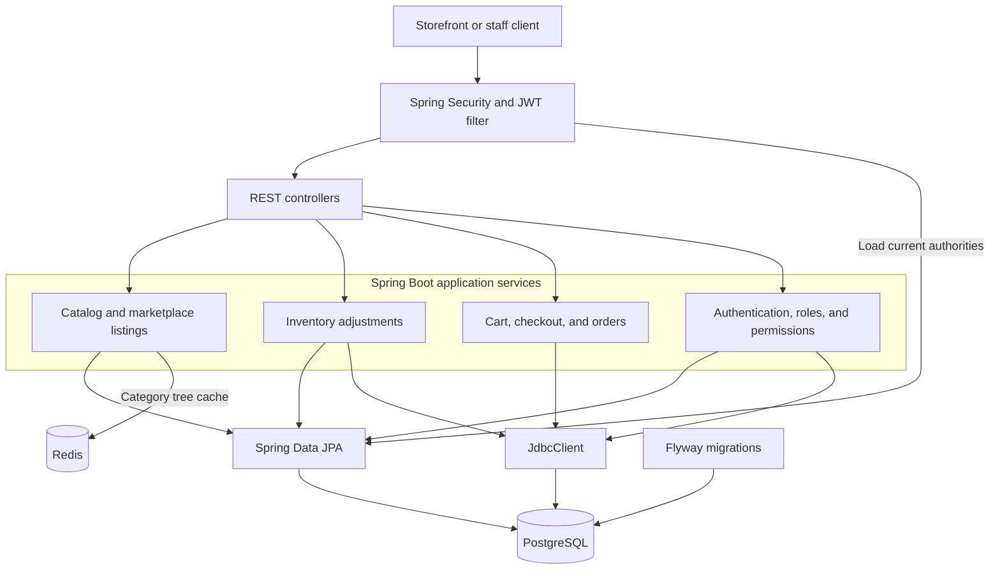
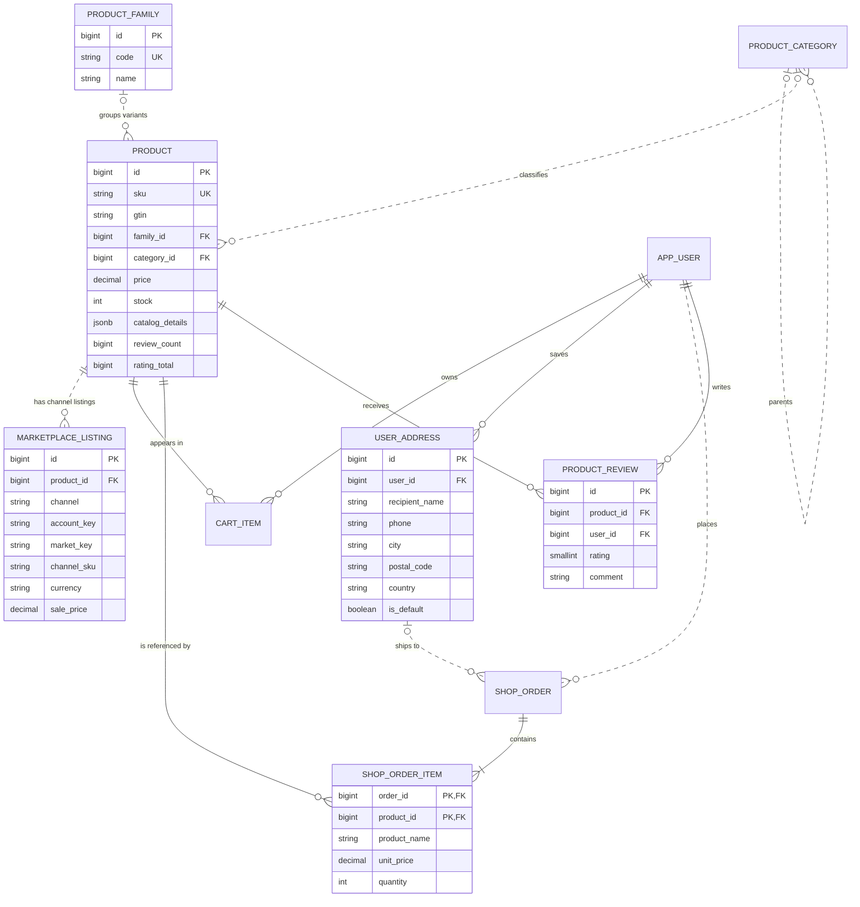
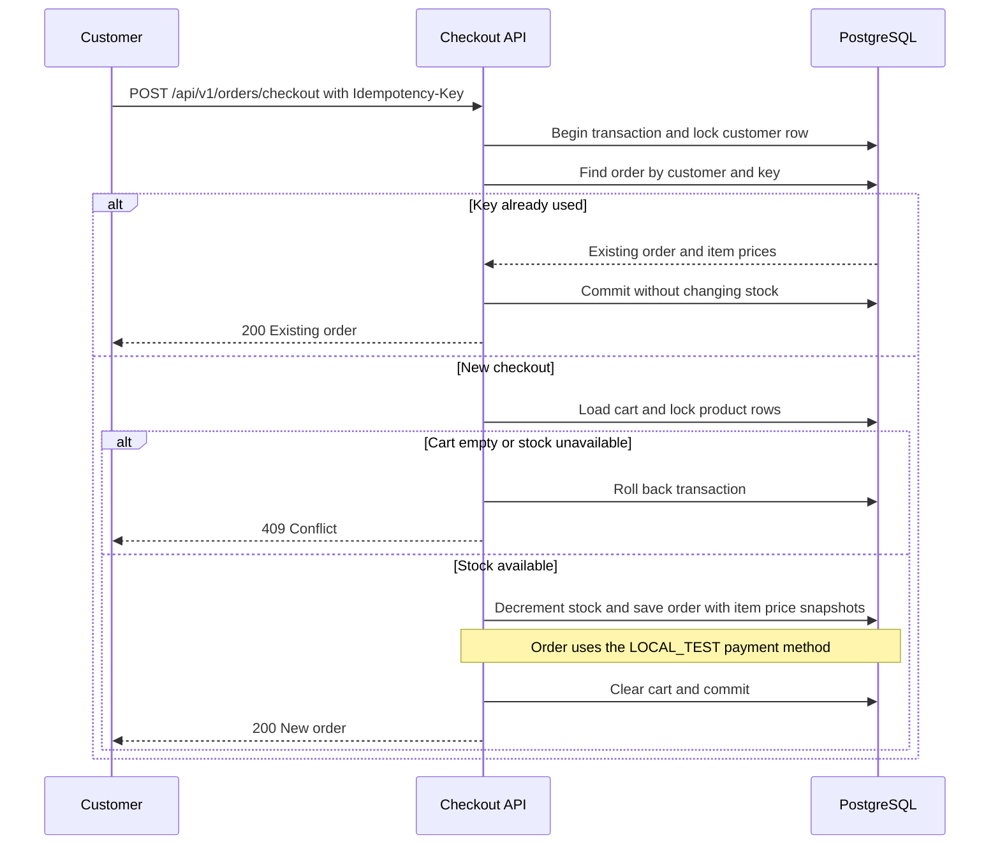
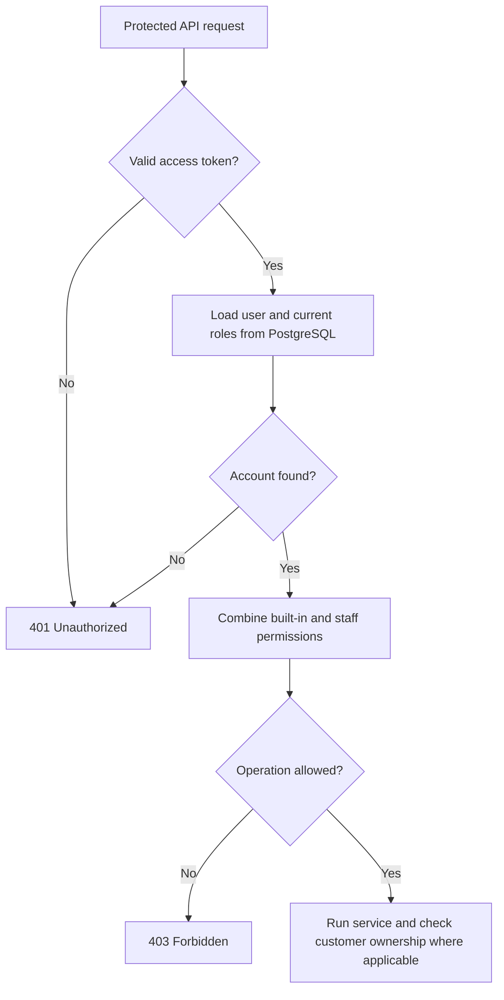

# Kips Shop

**English** | [Türkçe](README.tr.md)

Kips Shop is a Spring Boot e-commerce REST backend. It provides JWT authentication, a product catalog, category trees, carts, stock-aware checkout, and orders with local test payments.

## Stack

Java 25, Spring Boot 4.1.2, Gradle 9.8.1, PostgreSQL 15, Flyway, Redis 7, and SpringDoc OpenAPI.

## Architecture

### Application and infrastructure



### Catalog and order data

Each `PRODUCT` row represents a sellable SKU. A marketplace listing belongs to one SKU and is scoped by channel, seller account, and market. Order items retain the product name and unit price captured at checkout.



### Checkout and stock



### Request authorization



## Run locally

Create a local environment file from the template.

```bash
cp -n .env.example .env
```

Set `POSTGRES_PASSWORD` in `.env`. Generate a JWT key with `openssl rand -base64 32` and set it as `JWT_SECRET_KEY`. For an existing PostgreSQL volume, keep using that database user's current password.

```bash
docker compose up --build -d --wait
```

The API runs at [localhost:8080](http://localhost:8080), with [Swagger UI](http://localhost:8080/swagger-ui.html) and the [OpenAPI specification](http://localhost:8080/v3/api-docs). Set `POSTGRES_HOST_PORT=5433` in `.env` if port `5432` is occupied. PostgreSQL data persists in the `postgres_data` volume.

## API

| Method and path | Purpose |
| --- | --- |
| `POST /api/v1/auth/register` | Create a standard user using `username`, `email`, and `password` |
| `POST /api/v1/auth/authenticate` | Sign in with `username` and `password` |
| `POST /api/v1/auth/refresh` | Issue a new access token from the `refresh_token` field |
| `GET /api/v1/user/profile`, `PUT /api/v1/user/profile` | Read or update the signed-in user's `email` |
| `PUT /api/v1/user/password` | Change the signed-in user's password using `currentPassword` and `newPassword` |
| `GET /api/v1/addresses` | List the signed-in user's shipping addresses |
| `POST /api/v1/addresses`, `PUT /api/v1/addresses/{id}`, `DELETE /api/v1/addresses/{id}` | Create, update, or remove a shipping address |
| `POST /api/v1/addresses/{id}/default` | Mark an address as the default for future checkouts |
| `GET /api/v1/wishlist` | Read the signed-in user's wishlist with current price and stock |
| `PUT /api/v1/wishlist/items/{productId}`, `DELETE /api/v1/wishlist/items/{productId}` | Add a product to the wishlist (repeating is a no-op) or remove it |
| `GET /api/v1/products` | List products with pagination and optional `categoryId`, `familyId`, `sku`, `gtin`, and `q` filters |
| `GET /api/v1/products/{id}` | Read a product |
| `POST /api/v1/products`, `PUT /api/v1/products/{id}`, `DELETE /api/v1/products/{id}` | Manage products as an administrator |
| `GET /api/v1/products/{id}/reviews` | List a product's reviews, newest first, with pagination and `X-Total-Count`; products also expose `averageRating` and `reviewCount` |
| `POST /api/v1/products/{id}/reviews` | Review a purchased (`PAID` or `SHIPPED`) product with a 1-5 `rating` and optional `comment`; one review per user (`409` on repeat, `403` without a purchase) |
| `DELETE /api/v1/products/{id}/reviews/{reviewId}` | Remove an inappropriate review as catalog staff; the removal is audited |
| `GET /api/v1/product-families`, `GET /api/v1/product-families/{id}` | Browse variant groups |
| `POST /api/v1/admin/product-families`, `PUT /api/v1/admin/product-families/{id}`, `DELETE /api/v1/admin/product-families/{id}` | Manage variant groups |
| `PUT /api/v1/admin/products/{id}/metadata` | Update GTIN, family and variant details independently of price and stock |
| `GET /api/v1/admin/products/{id}/marketplace-listings`, `PUT` or `DELETE /api/v1/admin/products/{id}/marketplace-listings/{channel}` | Manage local Amazon, Hepsiburada, Trendyol, and n11 listings by account and market |
| `GET /api/v1/product-categories` | Read the cached category tree |
| `POST /api/v1/product-categories` | Create a category tree as an administrator or catalog staff member |
| `GET /api/v1/cart` | Read the signed-in user's cart |
| `PUT /api/v1/cart/items/{productId}`, `DELETE /api/v1/cart/items/{productId}` | Set a positive `quantity` or remove an item |
| `POST /api/v1/orders/checkout` | Check stock, record prices, snapshot the chosen `addressId`, and create a local test order |
| `GET /api/v1/orders`, `GET /api/v1/orders/{id}` | List and read the signed-in user's orders |
| `POST /api/v1/orders/{id}/cancel` | Cancel an unshipped order and restore stock |
| `POST /api/v1/admin/orders/{id}/ship` | Mark a paid order as shipped as an administrator |
| `GET /api/v1/admin/staff-roles?username=...` | Read a user's roles as an administrator |
| `PUT /api/v1/admin/staff-roles`, `DELETE /api/v1/admin/staff-roles` | Assign or revoke a staff role using `username` and `role` query parameters |
| `GET /api/v1/admin/staff-roles/permissions` | List manageable roles and available operational permissions |
| `GET /api/v1/admin/staff-roles/{role}/permissions`, `PUT /api/v1/admin/staff-roles/{role}/permissions` | Read or replace the operational permissions of a staff role |
| `PATCH /api/v1/staff/catalog/products/{id}/content` | Update product `name`, `description`, and `categoryId` as catalog staff |
| `POST /api/v1/staff/inventory/products/{id}/adjust` | Adjust stock with `Idempotency-Key`, a signed nonzero `delta`, and a `reason` as fulfillment staff |
| `GET /api/v1/staff/fulfillment/orders`, `GET /api/v1/staff/fulfillment/orders/{id}` | Read the paid order queue or packing details as fulfillment staff |
| `POST /api/v1/staff/fulfillment/orders/{id}/ship` | Mark a paid order as shipped as fulfillment staff |
| `GET /api/v1/staff/support/orders/{id}` | Read order status and masked email as support staff |

Send `Authorization: Bearer <access_token>` for catalog, cart, and order requests. A refresh token is accepted only by the refresh endpoint and retains its original expiry. Tokens from before the token format change require signing in again. Set a stable JWT key to keep tokens valid across restarts.

Product lists default to 20 rows, accept up to 100 per page, and include an `X-Total-Count` response header. The supported sort fields are `id`, `sku`, `name`, `price`, and `stock`. For example, `?page=0&size=20&sort=price,asc&categoryId=2`. Product creation requires `name`, `price`, an initial `stock`, and an existing `categoryId`. Catalog updates preserve current stock even if a legacy client sends `stock`. A product can also have a stable SKU, GTIN, family, and catalog metadata. See the [marketplace catalog model and request examples](MARKETPLACE_CATALOG.md). Category writes take a `categories` array whose entries may specify a `parentId` or contain nested `subCategories`.

To change existing stock, use the inventory adjustment endpoint. Retry the same adjustment with the same `Idempotency-Key` to get the original result. Reusing that key for the same account and product with a different `delta` or `reason` returns `409`.

Public registration assigns `ROLE_USER`. A trusted database operator can grant `ROLE_ADMIN` to a known account in a local environment using the following SQL, after replacing the username.

```sql
INSERT INTO user_roles (user_id, role_id)
SELECT u.id, r.id
FROM app_user u CROSS JOIN app_user_roles r
WHERE u.username = 'your-local-account' AND r.name = 'ROLE_ADMIN'
ON CONFLICT DO NOTHING;
```

Administrators can assign `ROLE_CATALOG_STAFF`, `ROLE_FULFILLMENT_STAFF`, and `ROLE_SUPPORT_AGENT`. Roles combine, and changes take effect on the next request with the existing access token. `ROLE_USER` grants access to the account’s own cart and orders. Staff role assignments and revocations, stock adjustments, and shipment transitions are recorded in `staff_audit_event`. See the [role and permission matrix](docs/issue-11-rbac.md) for details.

To change a staff role’s permissions, fetch its current set, then send the complete desired set with `PUT /api/v1/admin/staff-roles/{role}/permissions`. For example:

```json
{"permissions": ["ORDER_READ_FULFILLMENT", "ORDER_SHIP"]}
```

An empty set removes every permission granted by that staff role. Permissions from any other assigned roles continue to apply. Customer access, full catalog management, and staff role administration are fixed to their built-in roles. Each permission change records the previous and new sets in `staff_audit_event`.

Checkout requires an `Idempotency-Key` header of up to 128 characters and an `addressId` referencing one of the signed-in user's own addresses. Retries with the same key for the same account return the same order. The cart shows current prices. Checkout records prices, product names, and a shipping address snapshot in the order and adjusts stock in one transaction. The test payment uses TRY and is enabled by default in local Compose. Outside Compose, set `CHECKOUT_LOCAL_TEST_ENABLED=true` to enable it. The test flow requires no payment details.

A user can hold up to 20 saved addresses. The first address saved, or any address explicitly sent with `defaultAddress: true`, becomes the default and clears the previous default. Deleting an address does not affect past orders, since the shipping details are copied onto the order at checkout time.

Validation failures return `400`, missing or invalid authentication returns `401`, insufficient privileges returns `403`, and missing records return `404`. Conflicts such as duplicate registration and insufficient stock return `409`.

## Tests

Run `./gradlew test` with Java 25, an empty PostgreSQL test database, and Redis. Set `SPRING_DATASOURCE_URL`, `SPRING_DATASOURCE_USERNAME`, and `SPRING_DATASOURCE_PASSWORD` for the test database. Redis defaults to localhost and the tests use logical database 15. CI provisions both services before running the suite. The suite combines Mockito unit tests for service rules (default addresses, password changes, checkout input) with `@SpringBootTest` integration tests that call the HTTP API against PostgreSQL and Redis. The integration tests cover checkout idempotency, stock limits and concurrency, order cancellation and shipping, addresses, profile and password changes, and access control including other users' resources. Tests create their own users and products, so the suite can be re-run against the same database.

## License

[MIT](LICENSE)
