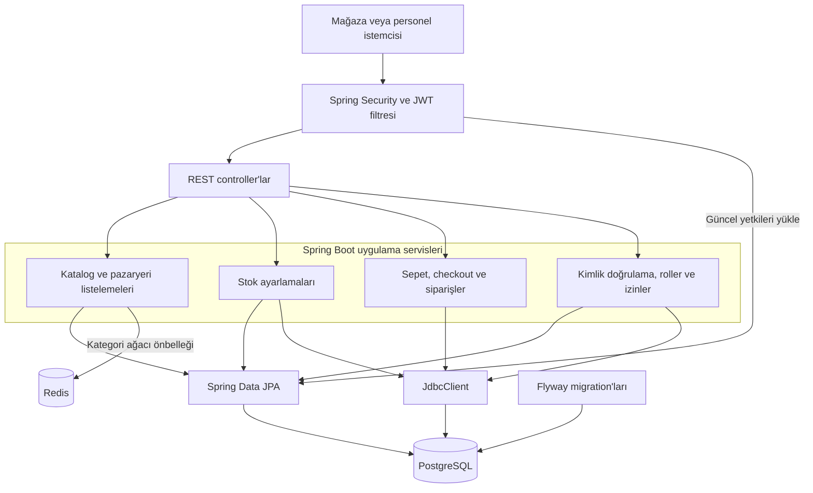
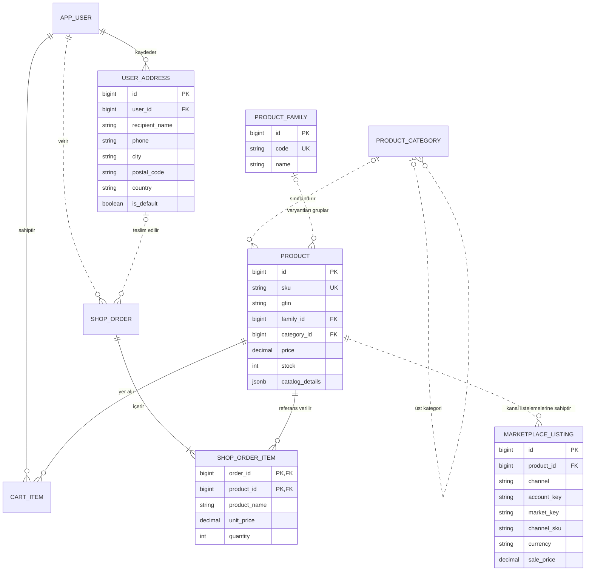
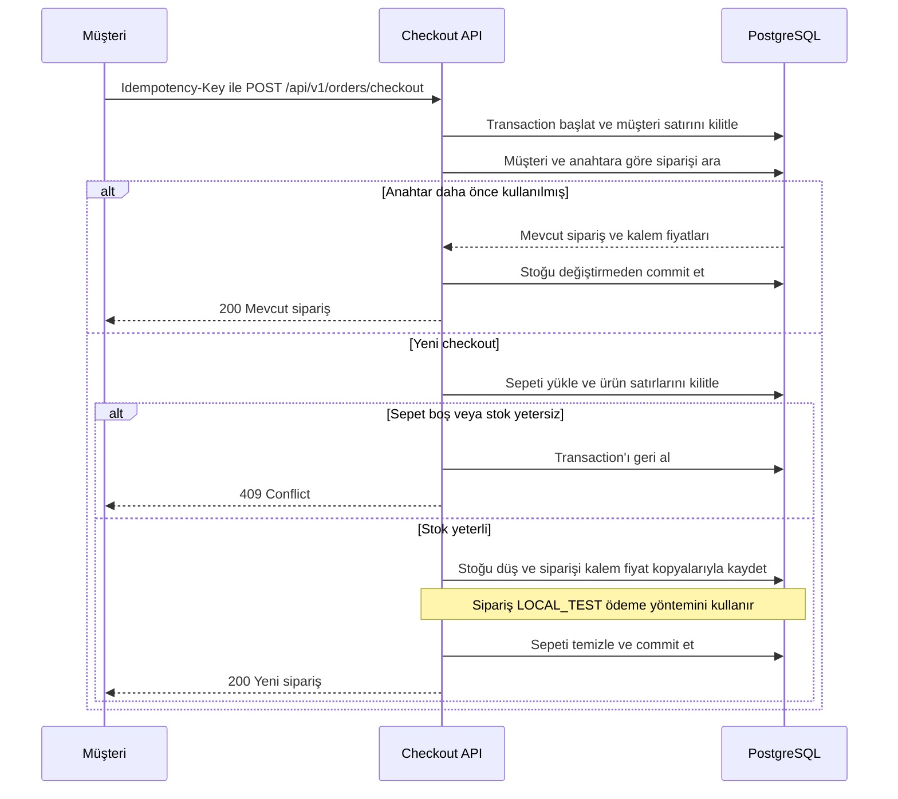
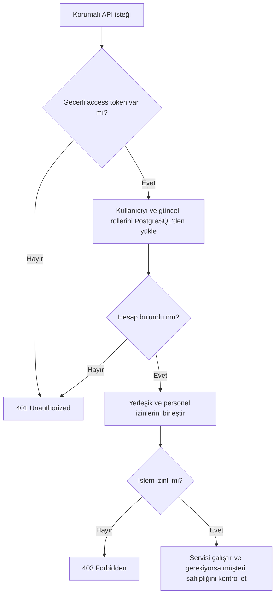

# Kips Shop

[English](README.md) | **Türkçe**

Kips Shop, Spring Boot ile yazılmış bir e-ticaret REST backend'idir. JWT kimlik doğrulama, ürün kataloğu, kategori ağaçları, sepet, stok kontrollü ödeme (checkout) ve yerel test ödemeli siparişler sunar.

## Teknoloji yığını

Java 25, Spring Boot 4.1.2, Gradle 9.8.1, PostgreSQL 15, Flyway, Redis 7 ve SpringDoc OpenAPI.

## Mimari

### Uygulama ve altyapı



### Katalog ve sipariş verisi

Her `PRODUCT` satırı satılabilir bir SKU'yu temsil eder. Pazaryeri listelemesi tek bir SKU'ya aittir ve kanal, satıcı hesabı ve pazar ile sınırlandırılır. Sipariş kalemleri, ödeme anındaki ürün adını ve birim fiyatı korur.



### Checkout ve stok



### İstek yetkilendirmesi



## Yerelde çalıştırma

Şablondan yerel bir ortam dosyası oluşturun.

```bash
cp -n .env.example .env
```

`.env` içinde `POSTGRES_PASSWORD` değerini ayarlayın. `openssl rand -base64 32` ile bir JWT anahtarı üretip `JWT_SECRET_KEY` olarak girin. Mevcut bir PostgreSQL volume'ü kullanıyorsanız, o veritabanı kullanıcısının mevcut parolasını kullanmaya devam edin.

```bash
docker compose up --build -d --wait
```

API [localhost:8080](http://localhost:8080) adresinde çalışır. [Swagger UI](http://localhost:8080/swagger-ui.html) ve [OpenAPI şeması](http://localhost:8080/v3/api-docs) da aynı adreste bulunur. `5432` portu doluysa `.env` içinde `POSTGRES_HOST_PORT=5433` ayarlayın. PostgreSQL verisi `postgres_data` volume'ünde kalıcıdır.

## API

| Metot ve yol | Amaç |
| --- | --- |
| `POST /api/v1/auth/register` | `username`, `email` ve `password` ile standart kullanıcı oluşturur |
| `POST /api/v1/auth/authenticate` | `username` ve `password` ile giriş yapar |
| `POST /api/v1/auth/refresh` | `refresh_token` alanından yeni bir access token üretir |
| `GET /api/v1/user/profile`, `PUT /api/v1/user/profile` | Oturum açmış kullanıcının `email` bilgisini okur veya günceller |
| `PUT /api/v1/user/password` | `currentPassword` ve `newPassword` ile kullanıcının parolasını değiştirir |
| `GET /api/v1/addresses` | Oturum açmış kullanıcının teslimat adreslerini listeler |
| `POST /api/v1/addresses`, `PUT /api/v1/addresses/{id}`, `DELETE /api/v1/addresses/{id}` | Teslimat adresi oluşturur, günceller veya siler |
| `POST /api/v1/addresses/{id}/default` | Adresi sonraki ödemeler için varsayılan yapar |
| `GET /api/v1/wishlist` | Oturum açmış kullanıcının favori listesini güncel fiyat ve stokla okur |
| `PUT /api/v1/wishlist/items/{productId}`, `DELETE /api/v1/wishlist/items/{productId}` | Ürünü favorilere ekler (tekrar eklemek etkisizdir) veya çıkarır |
| `GET /api/v1/products` | Ürünleri sayfalı listeler. İsteğe bağlı `categoryId`, `familyId`, `sku`, `gtin` ve `q` filtreleri vardır |
| `GET /api/v1/products/{id}` | Bir ürünü okur |
| `POST /api/v1/products`, `PUT /api/v1/products/{id}`, `DELETE /api/v1/products/{id}` | Yönetici olarak ürünleri yönetir |
| `GET /api/v1/product-families`, `GET /api/v1/product-families/{id}` | Varyant gruplarına göz atar |
| `POST /api/v1/admin/product-families`, `PUT /api/v1/admin/product-families/{id}`, `DELETE /api/v1/admin/product-families/{id}` | Varyant gruplarını yönetir |
| `PUT /api/v1/admin/products/{id}/metadata` | GTIN, aile ve varyant ayrıntılarını fiyat ve stoktan bağımsız günceller |
| `GET /api/v1/admin/products/{id}/marketplace-listings`, `PUT` veya `DELETE /api/v1/admin/products/{id}/marketplace-listings/{channel}` | Amazon, Hepsiburada, Trendyol ve n11 yerel listelemelerini hesap ve pazara göre yönetir |
| `GET /api/v1/product-categories` | Önbellekteki kategori ağacını okur |
| `POST /api/v1/product-categories` | Yönetici veya katalog personeli olarak kategori ağacı oluşturur |
| `GET /api/v1/cart` | Oturum açmış kullanıcının sepetini okur |
| `PUT /api/v1/cart/items/{productId}`, `DELETE /api/v1/cart/items/{productId}` | Pozitif bir `quantity` belirler veya kalemi kaldırır |
| `POST /api/v1/orders/checkout` | Stoğu kontrol eder, fiyatları kaydeder, seçilen `addressId` adresinin kopyasını alır ve yerel test siparişi oluşturur |
| `GET /api/v1/orders`, `GET /api/v1/orders/{id}` | Oturum açmış kullanıcının siparişlerini listeler ve okur |
| `POST /api/v1/orders/{id}/cancel` | Kargolanmamış siparişi iptal eder ve stoğu geri yükler |
| `POST /api/v1/admin/orders/{id}/ship` | Yönetici olarak ödenmiş siparişi kargolandı olarak işaretler |
| `GET /api/v1/admin/staff-roles?username=...` | Yönetici olarak bir kullanıcının rollerini okur |
| `PUT /api/v1/admin/staff-roles`, `DELETE /api/v1/admin/staff-roles` | `username` ve `role` sorgu parametreleriyle personel rolü atar veya geri alır |
| `GET /api/v1/admin/staff-roles/permissions` | Yönetilebilir rolleri ve kullanılabilir operasyonel izinleri listeler |
| `GET /api/v1/admin/staff-roles/{role}/permissions`, `PUT /api/v1/admin/staff-roles/{role}/permissions` | Bir personel rolünün operasyonel izinlerini okur veya değiştirir |
| `PATCH /api/v1/staff/catalog/products/{id}/content` | Katalog personeli olarak ürünün `name`, `description` ve `categoryId` alanlarını günceller |
| `POST /api/v1/staff/inventory/products/{id}/adjust` | Depo personeli olarak `Idempotency-Key`, sıfırdan farklı işaretli bir `delta` ve `reason` ile stoğu ayarlar |
| `GET /api/v1/staff/fulfillment/orders`, `GET /api/v1/staff/fulfillment/orders/{id}` | Depo personeli olarak ödenmiş sipariş kuyruğunu veya paketleme ayrıntılarını okur |
| `POST /api/v1/staff/fulfillment/orders/{id}/ship` | Depo personeli olarak ödenmiş siparişi kargolandı olarak işaretler |
| `GET /api/v1/staff/support/orders/{id}` | Destek personeli olarak sipariş durumunu ve maskelenmiş e-postayı okur |

Katalog, sepet ve sipariş istekleri için `Authorization: Bearer <access_token>` başlığını gönderin. Refresh token yalnızca refresh uç noktasında kabul edilir ve ilk son kullanma süresini korur. Token biçimi değişikliğinden önceki token'lar için yeniden giriş yapılması gerekir. Yeniden başlatmalarda token'ların geçerli kalması için sabit bir JWT anahtarı kullanın.

Ürün listeleri varsayılan olarak 20 satırdır, sayfa başına en fazla 100 satır kabul eder ve `X-Total-Count` yanıt başlığını içerir. Desteklenen sıralama alanları `id`, `sku`, `name`, `price` ve `stock` alanlarıdır. Örneğin `?page=0&size=20&sort=price,asc&categoryId=2`. Ürün oluşturmak için `name`, `price`, başlangıç `stock` değeri ve var olan bir `categoryId` gerekir. Eski bir istemci `stock` gönderse bile katalog güncellemeleri mevcut stoğu korur. Bir ürün ayrıca sabit bir SKU, GTIN, aile ve katalog metadata'sına sahip olabilir. [Pazaryeri katalog modeli ve istek örnekleri](MARKETPLACE_CATALOG.md) sayfasına bakın. Kategori yazma işlemleri, girdileri `parentId` belirtebilen veya iç içe `subCategories` içerebilen bir `categories` dizisi alır.

Mevcut stoğu değiştirmek için stok ayarlama uç noktasını kullanın. Aynı ayarlamayı aynı `Idempotency-Key` ile tekrarlarsanız ilk sonuç döner. Aynı hesap ve ürün için bu anahtarı farklı bir `delta` veya `reason` ile yeniden kullanmak `409` döndürür.

Herkese açık kayıt `ROLE_USER` atar. Güvenilir bir veritabanı operatörü, yerel ortamda bilinen bir hesaba `ROLE_ADMIN` rolünü, kullanıcı adını değiştirdikten sonra aşağıdaki SQL ile verebilir.

```sql
INSERT INTO user_roles (user_id, role_id)
SELECT u.id, r.id
FROM app_user u CROSS JOIN app_user_roles r
WHERE u.username = 'your-local-account' AND r.name = 'ROLE_ADMIN'
ON CONFLICT DO NOTHING;
```

Yöneticiler `ROLE_CATALOG_STAFF`, `ROLE_FULFILLMENT_STAFF` ve `ROLE_SUPPORT_AGENT` rollerini atayabilir. Roller birleşir ve değişiklikler mevcut access token ile yapılan bir sonraki istekte geçerli olur. `ROLE_USER`, hesabın kendi sepetine ve siparişlerine erişim verir. Personel rolü atama ve geri alma işlemleri, stok ayarlamaları ve kargolama geçişleri `staff_audit_event` tablosuna kaydedilir. Ayrıntılar için [rol ve izin matrisine](docs/issue-11-rbac.md) bakın.

Bir personel rolünün izinlerini değiştirmek için önce mevcut izin kümesini alın, ardından istenen tüm kümeyi `PUT /api/v1/admin/staff-roles/{role}/permissions` ile gönderin. Örneğin:

```json
{"permissions": ["ORDER_READ_FULFILLMENT", "ORDER_SHIP"]}
```

Boş küme, o personel rolünün verdiği tüm izinleri kaldırır. Atanmış diğer rollerden gelen izinler geçerli olmaya devam eder. Müşteri erişimi, tam katalog yönetimi ve personel rolü yönetimi yerleşik rollere sabitlenmiştir. Her izin değişikliği, önceki ve yeni kümeleri `staff_audit_event` tablosuna kaydeder.

Checkout, en fazla 128 karakterlik bir `Idempotency-Key` başlığı ve oturum açmış kullanıcının kendi adreslerinden birini işaret eden bir `addressId` gerektirir. Aynı hesap için aynı anahtarla yapılan tekrarlar aynı siparişi döndürür. Sepet güncel fiyatları gösterir. Checkout, fiyatları, ürün adlarını ve teslimat adresi kopyasını siparişe kaydeder ve stoğu tek bir transaction içinde ayarlar. Test ödemesi TRY kullanır ve yerel Compose'ta varsayılan olarak etkindir. Compose dışında etkinleştirmek için `CHECKOUT_LOCAL_TEST_ENABLED=true` ayarlayın. Test akışı ödeme bilgisi gerektirmez.

Bir kullanıcı en fazla 20 kayıtlı adres tutabilir. İlk kaydedilen adres veya `defaultAddress: true` ile açıkça gönderilen adres varsayılan olur ve önceki varsayılanı temizler. Teslimat bilgileri ödeme anında siparişe kopyalandığı için bir adresi silmek geçmiş siparişleri etkilemez.

Doğrulama hataları `400`, eksik veya geçersiz kimlik doğrulama `401`, yetersiz yetki `403`, bulunamayan kayıtlar `404` döndürür. Mükerrer kayıt ve yetersiz stok gibi çakışmalar `409` döndürür.

## Testler

Java 25, boş bir PostgreSQL test veritabanı ve Redis ile `./gradlew test` komutunu çalıştırın. Test veritabanı için `SPRING_DATASOURCE_URL`, `SPRING_DATASOURCE_USERNAME` ve `SPRING_DATASOURCE_PASSWORD` değerlerini ayarlayın. Redis varsayılan olarak localhost'tur ve testler 15 numaralı mantıksal veritabanını kullanır. CI, test paketini çalıştırmadan önce her iki servisi de hazırlar.

## Lisans

[MIT](LICENSE)
